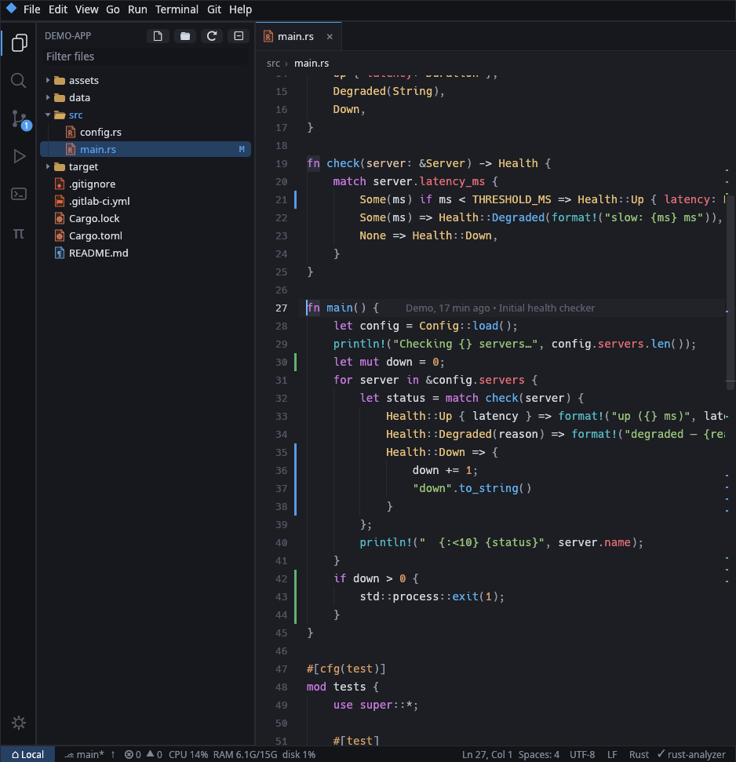
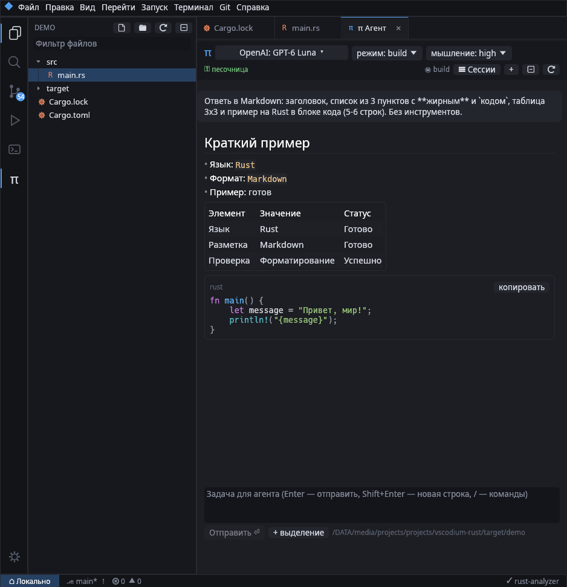
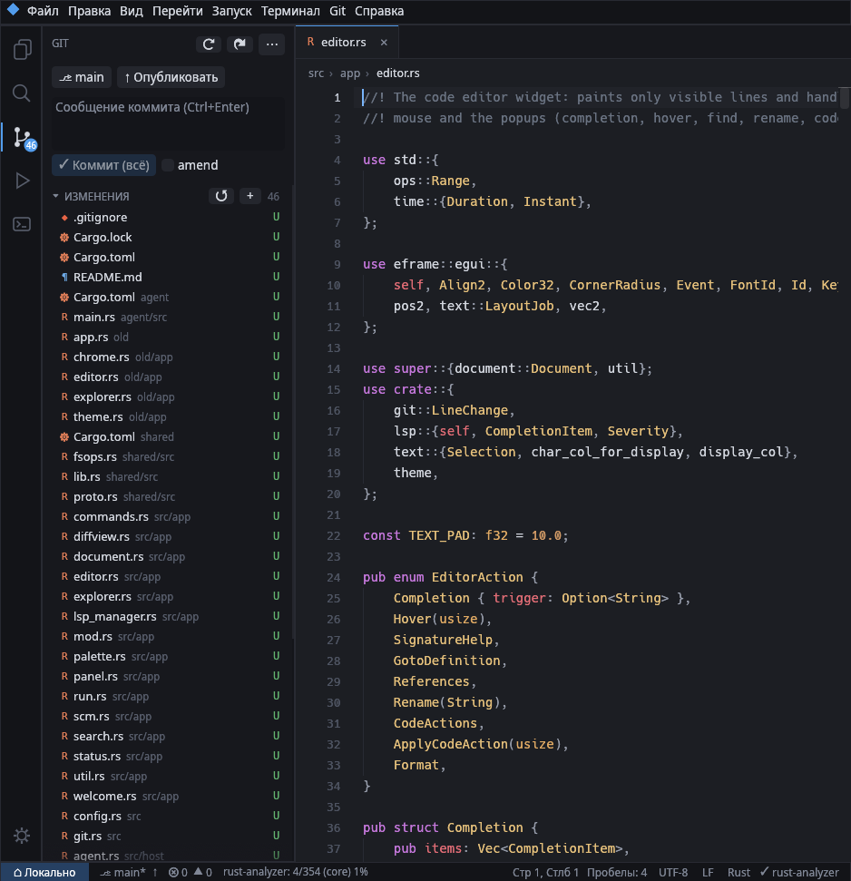
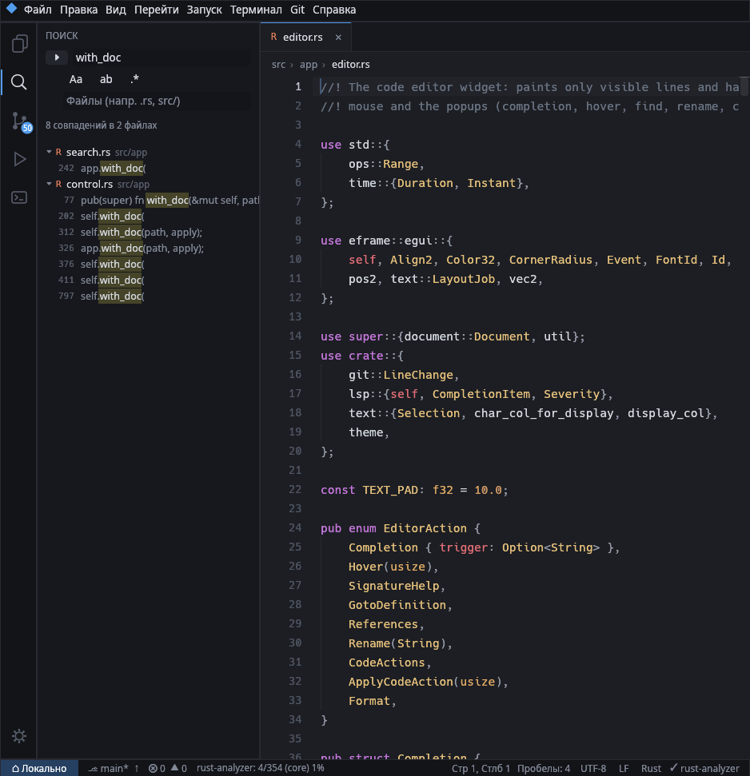
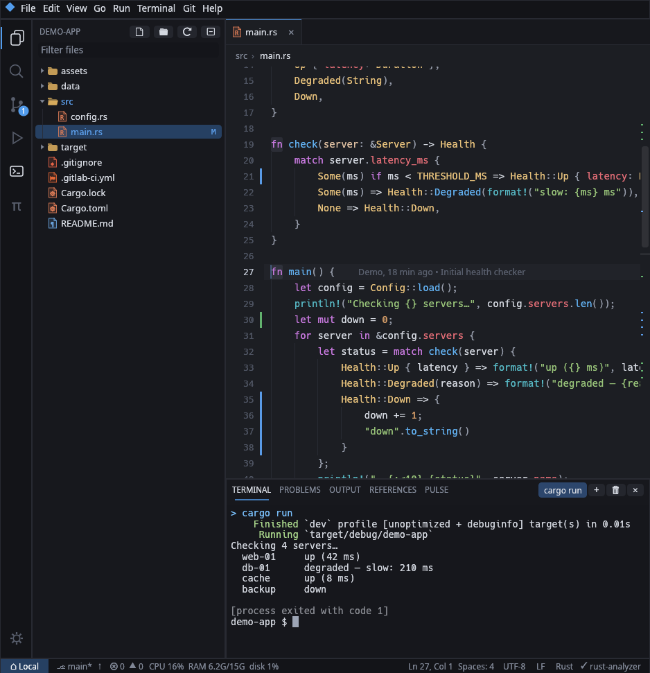
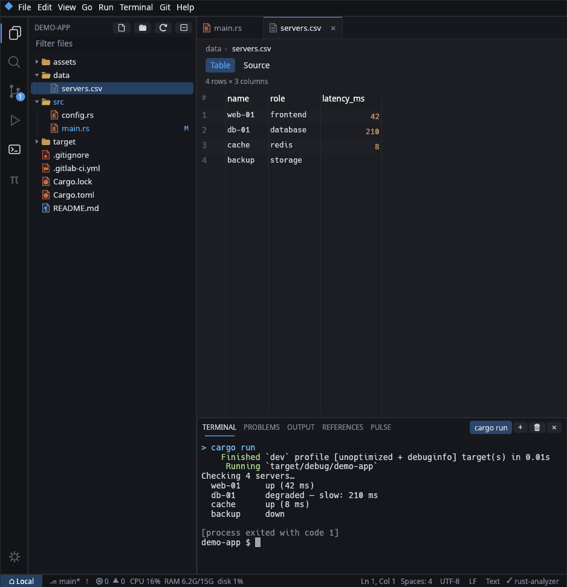
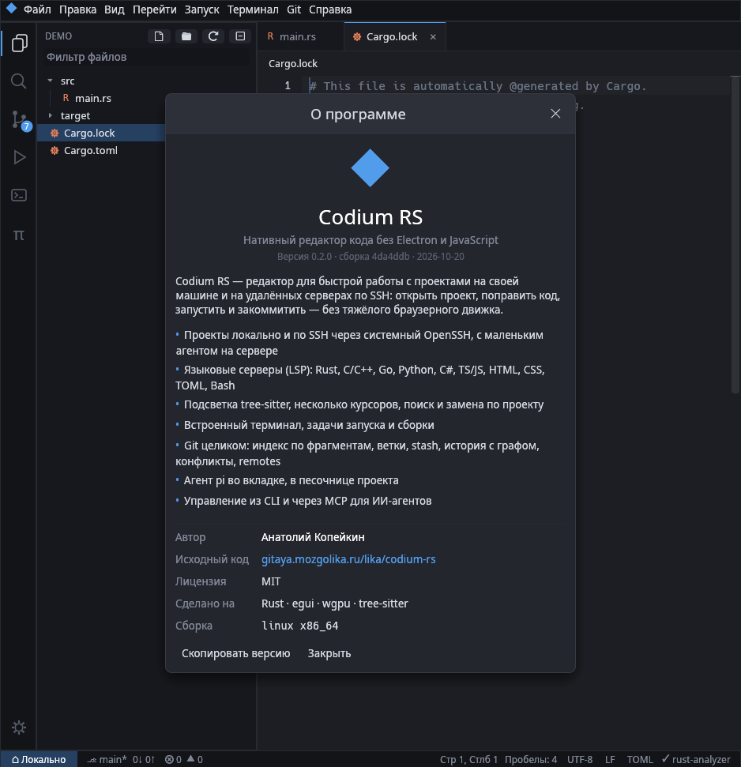

<div align="center">

[Agent sessions (RU)](docs/pi-sessions.ru.md) · [Pi integration audit](docs/pi-integration-audit.md)

# ◆ Lumen Edit

**A native code editor in Rust — no Electron, no JavaScript.**
Open a project locally or on a remote machine over SSH, edit with full language-server support, run it in the built-in terminal, and manage git — all in a single fast binary.

[](https://github.com/anatoliiii/lumen-edit/actions/workflows/ci.yml)
[](LICENSE)


[Русская версия](README.ru.md)



</div>

## Features

- **Editor** — custom widget that paints only visible lines over a rope buffer; multiple cursors (Alt+click, Ctrl+D), auto-closing brackets, smart indent, line move/duplicate, comment toggle, find & replace with regex, bracket and occurrence highlighting.
- **Syntax highlighting** with tree-sitter: Rust, Bash, Python, C, C++, C#, Go, HTML, CSS, JavaScript, TypeScript/TSX, JSON, TOML, YAML, Makefile, Groovy (Jenkinsfile), HCL (Terraform), Dockerfile.
- **[AI inline completion](docs/inline-completion.md)** — opt in per project, then type and accept ghost text with Tab. OpenRouter Codestral with LSP/tree-sitter context, Pi credentials, cancellation and atomic Undo.
- **Language servers (LSP)** — completion, hover, signature help, go to definition, references, rename, code actions, formatting, inline diagnostics. Only native servers by default (no Node.js).
- **Remote development over SSH** — uses your system OpenSSH (`~/.ssh/config`, keys, agent, ProxyJump, password and 2FA prompts) with one multiplexed connection for files, terminals, git and language servers. An optional tiny static agent (`lumen-agent`) is uploaded automatically for fast search and file watching; without it everything works over plain shell commands.
- **Integrated terminal** — real PTY (vim, htop, mc work), multiple tabs, Ctrl+click on `file:line:col` opens it in the editor.
- **Git** — status in the tree, stage/unstage/revert per file or hunk, commit/amend, push/pull/fetch/sync, branches (switch, create, merge, rebase, delete), remotes, stash, history graph (cherry-pick, revert, reset), inline blame, gutter change markers, merge-conflict resolution buttons in the editor.
- **Tasks** — auto-detected for Cargo, Go, CMake, Meson, Make, just, Python, .NET and package.json, plus your own in `.lumen/tasks.toml`. F5 runs, Ctrl+Shift+B builds.
- **Server pulse** — live CPU, memory, disks and top processes of the project host (local or SSH) in the status bar and a panel with charts; warns before a build fills the disk; kill processes from the list.
- **Teleport** — two-pane file transfer between this computer, the project host and any other connected SSH host (server to server too), streamed as `tar | tar` through the open connections with progress and cancel. Drop files from your desktop into the window to upload them into the project, even on a remote server.
- **CI/CD aware** — GitLab CI, GitHub/Gitea/Forgejo Actions, Woodpecker, Drone, Bitbucket, Azure, CircleCI, Travis, Jenkinsfile, Dockerfile, Compose, Kubernetes, Ansible and Terraform are recognised by path: platform icons, pipeline keys, job names, `${{ }}` expressions and `$VARIABLES` highlighted on top of YAML.
- **Markdown preview** — `.md` files open rendered (tables, task lists, highlighted code, local images); toggle with Ctrl+Alt+P.
- **Images, SVG and tables** — PNG, JPEG, GIF, WebP, BMP and ICO open in a viewer with zoom; SVG shows a live preview next to its source; CSV/TSV open as a table (delimiter detected, quoted fields supported).
- **pi agent tab** — the [pi coding agent](https://pi.dev) with your own configuration, rendered as a real chat (streaming Markdown, tool cards, model/mode/thinking pickers, sessions), sandboxed with bubblewrap.
- **English and Russian interface** — follows the system locale; switch it in Settings → Language.
- **CLI and MCP** — every GUI command and more (buffers, LSP, diagnostics, search, git, terminals, shell on the project host, screenshots) is scriptable from the command line and exposed to AI agents via MCP.

<table>
<tr>
<td></td>
<td></td>
</tr>
<tr>
<td></td>
<td></td>
</tr>
<tr>
<td></td>
<td></td>
</tr>
</table>

## Installation

Requirements: Linux or macOS (x86_64 or aarch64; Windows builds too), Rust 1.95 or newer, `git`, `ssh`. Optional: `bwrap` for the agent sandbox, `shellcheck`, language servers.

```sh
git clone https://github.com/anatoliiii/lumen-edit.git
cd lumen-edit
./scripts/install.sh
```

The installer builds the editor and the remote agents, installs `~/.local/bin/lumen-edit`, a desktop entry and icon, and registers the MCP server in Claude Code if it is installed. No root needed.
On macOS it installs `~/Applications/Lumen Edit.app` and links `~/.local/bin/lumen-edit` to it. Release archives for macOS hold an unsigned app: run `xattr -dr com.apple.quarantine "Lumen Edit.app"` once after unpacking.

Any OS connects to any other over SSH: the agent is picked by the host's `uname` (`lumen-agent-<os>-<arch>`). `build-agents.sh` builds the Linux agents everywhere and the native ones on macOS and Windows; release archives carry agents for all of them. A Windows host needs OpenSSH with Git Bash as its shell (`DefaultShell` in the registry).

Manual build:

```sh
cargo build --release
./scripts/build-agents.sh   # lumen-agent for Linux x86_64/aarch64 (musl) and this OS
./target/release/lumen-edit
```

## Usage

```sh
lumen-edit                         # open the window
lumen-edit ~/project               # open a folder
lumen-edit src/main.rs:42          # open a file in the running window, like `code`
lumen-edit ssh://host/path         # open a project on an SSH host
```

| Shortcut | Action |
|---|---|
| Ctrl+P / Ctrl+Shift+P | Go to file / command palette |
| Ctrl+Shift+E / F / G / R | Explorer / search / git / tasks |
| Ctrl+` | Terminal |
| F5 / Ctrl+Shift+B | Run / build |
| F12 / Shift+F12 / F2 / Ctrl+. | Definition / references / rename / quick fix |
| Ctrl+Shift+A | pi agent |
| Ctrl+Alt+T | Teleport (file transfer) |
| Ctrl+Alt+P | Markdown preview / source |

## Language servers

All defaults are native binaries; missing ones are simply skipped.

| Language | Server |
|---|---|
| Rust | `rust-analyzer` |
| C / C++ | `clangd` |
| Go | `gopls` |
| Python | `ty server` + `ruff server` (fallback `pylsp`) |
| C# | `csharp-ls` (fallback `OmniSharp`) |
| TypeScript / JavaScript | `tsgo --lsp --stdio` + `biome lsp-proxy` |
| CSS, JSON | `biome lsp-proxy` |
| HTML | `superhtml lsp` |
| TOML | `taplo lsp stdio` |
| Bash | `shellcheck` diagnostics |

Add or replace servers in `~/.config/lumen-edit/config.toml`:

```toml
[[lsp]]
name = "zls"
command = "zls"
languages = ["zig"]
```

## CLI and MCP

A running editor listens on `$XDG_RUNTIME_DIR/lumen-edit/ctl-<pid>.sock`.

```sh
lumen-edit methods                   # all methods; `lumen-edit help <method>` for parameters
lumen-edit state                     # project, open files, cursor, git, problems
lumen-edit cmd git_sync              # any menu command (`lumen-edit commands`)
lumen-edit read_file src/lib.rs --line_numbers
lumen-edit hover src/lib.rs 10 5
lumen-edit exec 'cargo test'         # runs on the project host, keeps the exit code
lumen-edit agent prompt "fix the failing test"
```

MCP server over stdio:

```sh
claude mcp add lumen -- lumen-edit mcp
```

Tools are grouped by entity (`state`, `workspace`, `file`, `search`, `code`, `exec`, `terminal`, `task`, `git`, `command`, `agent`, `pulse`, `transfer`) to keep the catalog small (~3k tokens). `lumen-edit mcp --granular` exposes one tool per method for clients that search tools on demand.

## Configuration

`~/.config/lumen-edit/config.toml`, or the Settings window (Ctrl+,): interface language, fonts, indentation, format on save, auto save, blame, SSH agent, `pull --rebase`, language servers, pi command/model/mode and sandbox.

### Keyboard shortcuts

Every shortcut can be changed in **Keyboard Shortcuts** (Ctrl+Alt+K, or File → Keyboard Shortcuts): search a command by its English or Russian name, its id or its keys (`ctrl+shift+p`, `f5`), or press **Record keys** and hit the shortcut itself. Click a shortcut to record a new one, × removes it, ↺ goes back to the default; keys taken from another command are removed there. The command palette finds commands the same way.

Changes are stored as overrides in `config.toml`. There `Ctrl` is the primary modifier, so it means Cmd on macOS, and `MacCtrl` is the Control key of a Mac (plain Ctrl elsewhere); the window itself shows macOS chords as `Cmd+F`, `Ctrl+``. On macOS the terminal, tab switching and suggestions use Control (Ctrl+`, Ctrl+Tab, Ctrl+Space), because the system keeps Cmd+`, Cmd+Tab and Cmd+Space.

```toml
[keybindings]
quick_open = ["Ctrl+E"]          # replaces the default Ctrl+P
toggle_terminal = ["Ctrl+`", "Alt+F12"]
quit = []                        # no shortcut
```

`lumen-edit commands` lists the ids. Arrows, Home/End, Page Up/Down, Backspace, Delete, Enter, Tab and Escape are fixed. Copying and pasting are commands too: Copy, Cut and Paste in the editor (Ctrl+C / Ctrl+X / Ctrl+V), Terminal: Copy Selection and Terminal: Paste in the terminal (Ctrl+C or Ctrl+Shift+C, Ctrl+V or Ctrl+Shift+V). Take Ctrl+V away from Terminal: Paste and the terminal gets ^V instead, as Ctrl+C without a selection sends ^C.

## Architecture

```text
shared/   agent protocol, filesystem and search operations shared by editor and agent
agent/    lumen-agent — helper uploaded to SSH hosts
src/
  host/       local host and SSH: ControlMaster, agent client, shell fallback
  text.rs     rope buffer, selections, undo/redo
  syntax.rs   tree-sitter highlighting on a background thread
  lsp/        LSP client and shellcheck
  terminal.rs PTY + vt100
  git.rs      git through the command line (same locally and over SSH)
  control/    control socket, method registry, MCP server
  app/        UI: editor, explorer, search, git, panels, palette, agent, SSH flow
  i18n.rs     interface language, t!() and t_file!()
locales/      translations (ru.toml) and long texts per language
```

## Development

```sh
cargo test --workspace                 # unit and integration tests (SSH mode via a fake ssh)
cargo test -- --ignored                # tests that need rust-analyzer
PATH=$PWD/scripts/fake-ssh-dir:$PATH cargo run -- ssh://fake$PWD   # try remote mode without sshd
LUMEN_LOG=1 cargo run                 # log LSP and control traffic
```

See [CONTRIBUTING.md](CONTRIBUTING.md).

## License

[MIT](LICENSE) © Анатолий Копейкин (Anatolii Kopeikin)
