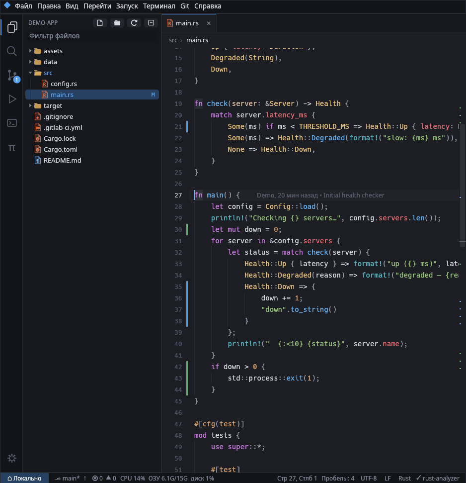
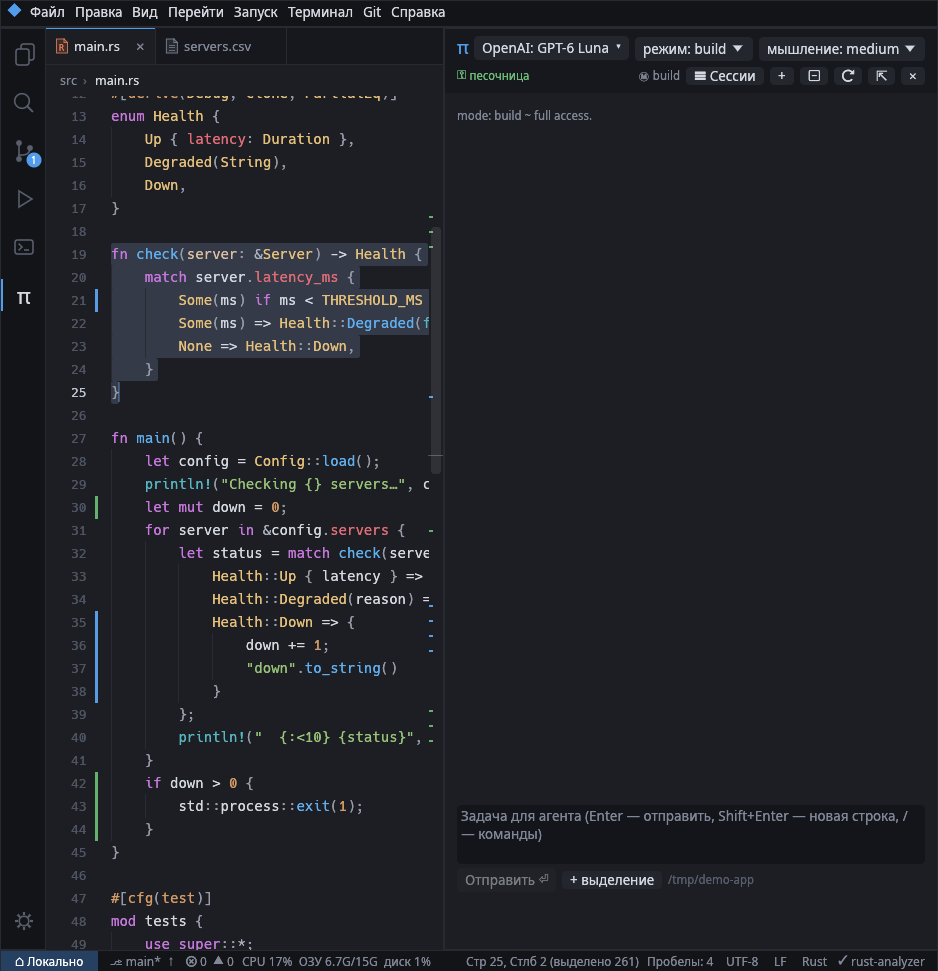
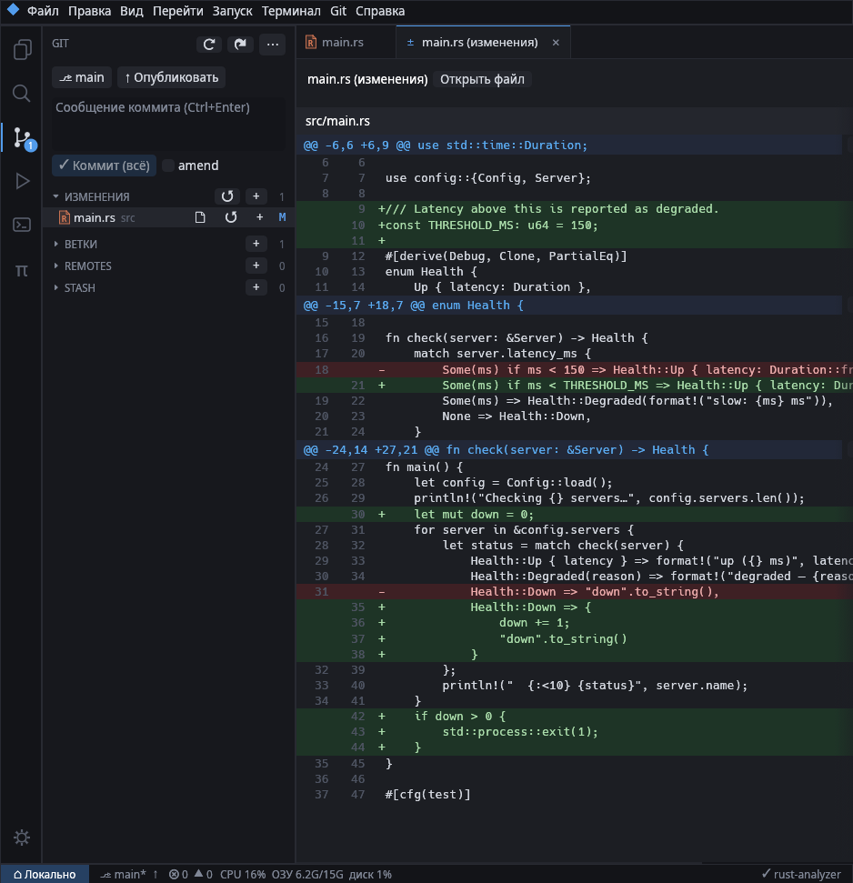
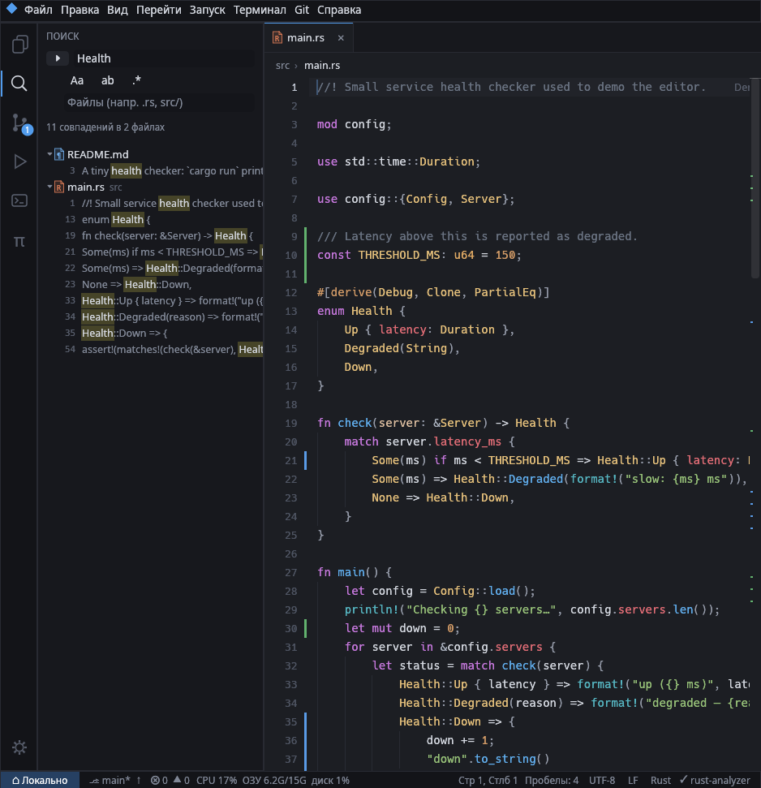
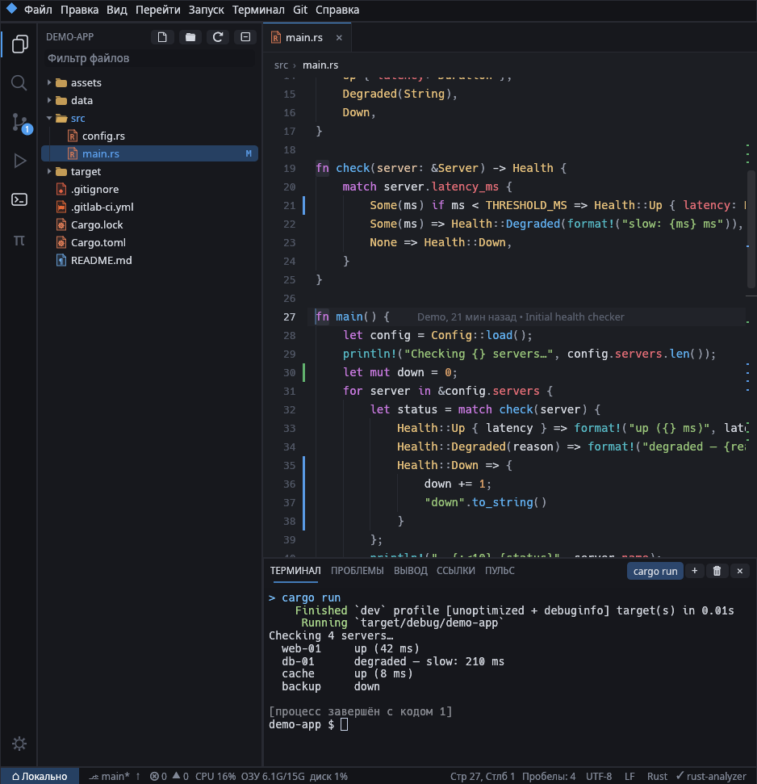
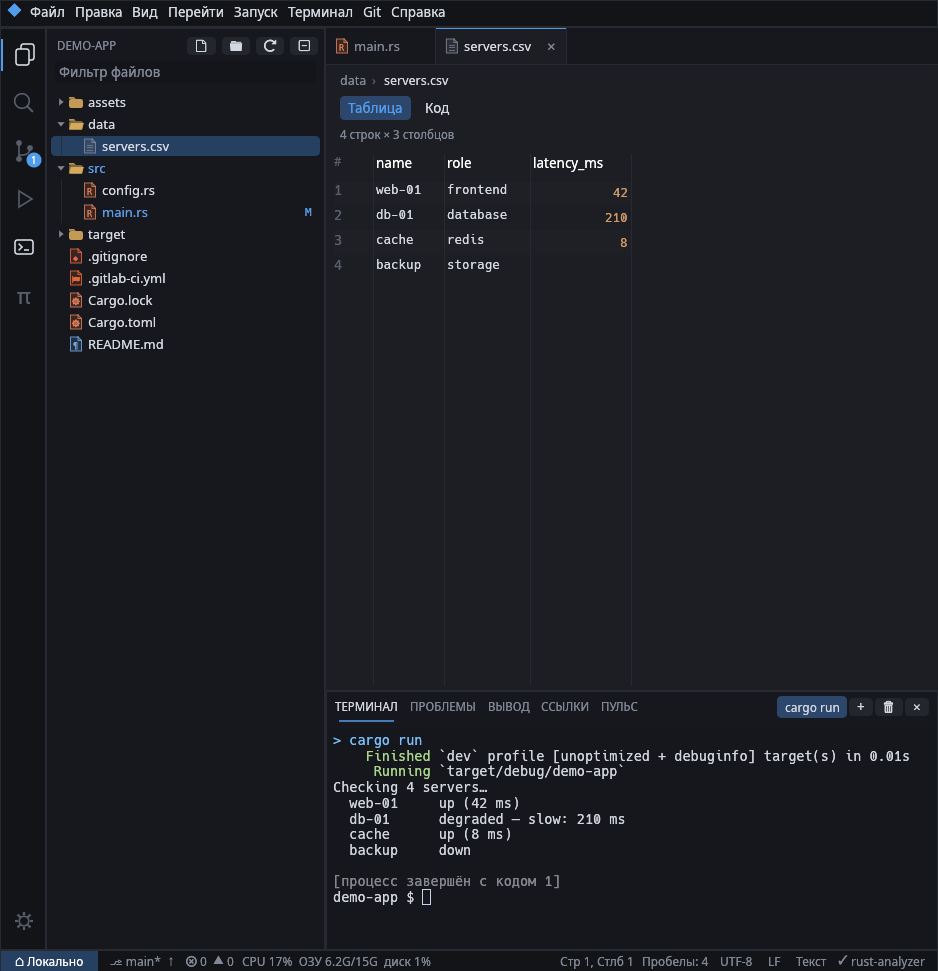
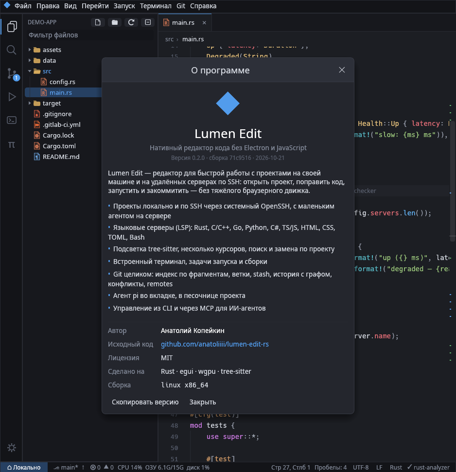

# Lumen Edit

[English](README.md) · [Лицензия MIT](LICENSE) · [Как участвовать](CONTRIBUTING.md)



Нативный редактор кода на Rust + egui (wgpu) без Electron и без JS. Быстро открыть
проект локально или на удалённой машине по SSH, править, запускать во встроенном
терминале и работать с git.

## Возможности

- **Редактор**: свой виджет (рисуются только видимые строки, rope-буфер), несколько
  курсоров (Alt+клик, Ctrl+D, Ctrl+Alt+↑/↓), автозакрытие скобок, умные отступы,
  перемещение и дублирование строк, комментирование, поиск и замена (regex),
  подсветка парных скобок и вхождений слова, направляющие отступов.
- **Подсветка синтаксиса** (tree-sitter): Rust, Bash, Python, C, C++, C#, Go, HTML,
  CSS, JavaScript, TypeScript/TSX, JSON, TOML.
- **LSP**: автодополнение, hover, сигнатуры, переход к определению (F12, Ctrl+клик),
  ссылки (Shift+F12), переименование (F2), быстрые исправления (Ctrl+.), форматирование,
  диагностика с подчёркиванием и сообщением в конце строки.
- **SSH**: используется системный OpenSSH (ваш `~/.ssh/config`, ключи, агент,
  ProxyJump, пароли и 2FA вводятся в окне подключения). Одно мастер-соединение
  (ControlMaster) на всё: файлы, терминал, git, языковые серверы запускаются на
  удалённой машине.
- **Агент** (`lumen-agent`): маленький статический бинарник, который редактор сам
  загружает на хост (`~/.cache/lumen-edit/`). Даёт быстрый поиск и слежение за файлами.
  Без него всё работает через обычные shell-команды. Подключаться можно с любой ОС
  на любую: агент выбирается по `uname` хоста (`lumen-agent-<ос>-<arch>`). Хосту на
  Windows нужен OpenSSH с Git Bash в качестве оболочки (`DefaultShell` в реестре).
- **Терминал**: полноценный (vim, htop, mc), несколько вкладок, Ctrl+клик по
  `файл:строка:столбец` открывает место в редакторе.
- **Git**: статус в дереве и отдельная панель, stage/unstage/откат файлов и отдельных
  фрагментов, коммит/amend, push/pull/fetch/sync, ветки (переключение, создание,
  merge, rebase, удаление), stash, история с графом (cherry-pick, revert, reset),
  blame текущей строки, отметки изменений у номеров строк, разрешение конфликтов
  кнопками прямо в редакторе, продолжение/прерывание merge и rebase.
- **Задачи**: автоопределение для Cargo, Go, CMake, Meson, Make, just, Python, .NET,
  package.json и свои задачи в `.lumen/tasks.toml`. F5 — запуск, Ctrl+Shift+B — сборка.

## CLI и MCP

Запущенный редактор слушает управляющий сокет `$XDG_RUNTIME_DIR/lumen-edit/ctl-<pid>.sock`.
Через него доступны все команды GUI и не только: чтение и правка буферов,
LSP-запросы, диагностика, поиск, git, терминалы, выполнение команд на хосте проекта
(в том числе по SSH), скриншот окна.

```sh
lumen-edit src/main.rs:42            # открыть в уже запущенном окне (как `code`)
lumen-edit state                     # что открыто, курсор, git, ошибки
lumen-edit methods                   # все методы; lumen-edit help <метод> — параметры
lumen-edit commands                  # id всех команд меню
lumen-edit cmd git_sync              # любая команда меню
lumen-edit read_file src/lib.rs start_line=1 end_line=50 --line_numbers
lumen-edit edit src/lib.rs '[{"start_line":3,"start_column":1,"end_line":3,"end_column":1,"text":"// hi\n"}]' --save
lumen-edit hover src/lib.rs 10 5     # definition / references / completion так же
lumen-edit diagnostics
lumen-edit search 'TODO' --include .rs
lumen-edit exec 'cargo test'         # на хосте проекта, код выхода сохраняется
lumen-edit terminal_new --command 'cargo run'; lumen-edit terminal_read --wait_ms 2000
lumen-edit git_commit 'fix: …' --all
lumen-edit screenshot path=shot.png
```

Аргументы: `key=value`, `--key value`, `--flag`, JSON или значения по порядку; `--json`
печатает сырой JSON. Несколько окон: `lumen-edit instances`, выбор — `LUMEN_SOCKET=…`.

**MCP** (`lumen-edit mcp`, stdio) — для Claude Code и других агентов:

```sh
claude mcp add lumen -- /путь/к/lumen-edit mcp
```

Инструменты сгруппированы по сущностям, чтобы не занимать контекст агента (10
инструментов, ~2,7 тыс. токенов): `state`, `workspace`, `file`, `search`, `code`, `exec`,
`terminal`, `task`, `git`, `command`; операция выбирается параметром `action`
(`file` + `action: "edit"` и т.д.). Если редактор не запущен, MCP-сервер запускает его
сам (отключить: `LUMEN_MCP_NO_LAUNCH=1`).

## Свои фишки

- **Пульс сервера** — живые CPU, память, диски и топ процессов хоста проекта (локально или по SSH) в строке состояния и на панели «ПУЛЬС» с графиками; предупреждение до того, как сборка упрётся в диск; остановка процессов из списка.
- **Телепорт** (Ctrl+Alt+T) — двухпанельная передача файлов между этим компьютером, хостом проекта и любым подключённым SSH-хостом (и сервер↔сервер), потоком `tar | tar` через открытые соединения, с прогрессом и отменой. Файлы, брошенные в окно из файлового менеджера, заливаются в папку проекта, в том числе на сервер.
- **CI/CD** — GitLab CI, GitHub/Gitea/Forgejo Actions, Woodpecker, Drone, Bitbucket, Azure, CircleCI, Travis, Jenkinsfile, Dockerfile, Compose, Kubernetes, Ansible, Terraform узнаются по пути: значки платформ, ключи схемы, имена джобов, `${{ }}` и `$ПЕРЕМЕННЫЕ` подсвечены поверх YAML.
- **Markdown** открывается сразу отрендеренным (таблицы, чекбоксы, код с подсветкой, локальные картинки); Ctrl+Alt+P — просмотр/код.
- **Картинки, SVG и таблицы** — PNG, JPEG, GIF, WebP, BMP и ICO открываются в просмотрщике с масштабом; SVG — живой просмотр рядом с исходником; CSV/TSV — таблицей (разделитель определяется сам, поля в кавычках поддерживаются).
- **Агент pi** (Ctrl+Shift+A) — [pi](https://pi.dev) с вашими настройками, расширениями и навыками, справа от кода как обычный чат: Markdown, карточки инструментов, выбор модели, режима и уровня мышления, сессии. «π Спросить агента» в контекстном меню выделения, отправка файлов и фрагментов, ссылки на файлы в ответах открываются в редакторе. Работает в песочнице bubblewrap и по SSH (через инструменты редактора).
- **Интерфейс на русском и английском** — по языку системы; переключается в «Настройки → Язык».

<table>
<tr>
<td></td>
<td></td>
</tr>
<tr>
<td></td>
<td></td>
</tr>
<tr>
<td></td>
<td></td>
</tr>
</table>

## Языковые серверы (только нативные, без Node.js)

| Язык | Сервер |
|---|---|
| Rust | `rust-analyzer` |
| C / C++ | `clangd` |
| Go | `gopls` |
| Python | `ty server` + `ruff server` (запасной вариант — `pylsp`) |
| C# | `csharp-ls` (запасной вариант — `OmniSharp -lsp`) |
| TS / JS | `tsgo --lsp --stdio` + `biome lsp-proxy` |
| CSS, JSON | `biome lsp-proxy` |
| HTML | `superhtml lsp` |
| TOML | `taplo lsp stdio` |
| Bash | `shellcheck` (диагностика) |

Сервер должен быть установлен там, где лежит проект (локально или на SSH-хосте).
Отсутствующие просто не запускаются; список виден во вкладке «Вывод». Отключить
сервер можно в настройках, добавить свой — в `~/.config/lumen-edit/config.toml`:

```toml
[[lsp]]
name = "zls"
command = "zls"
languages = ["zig"]
```

## Сборка и запуск

```sh
cargo build --release
./scripts/build-agents.sh          # агенты для Linux x86_64/aarch64 (musl) и для этой ОС
./target/release/lumen-edit [папка [файл]]
./target/release/lumen-edit ssh://host/путь/к/проекту
```

Для агентов нужны цели `rustup target add x86_64-unknown-linux-musl aarch64-unknown-linux-musl`;
C-тулчейн для кросс-сборки не нужен (линкуется встроенным `rust-lld`). Редактор ищет
агентов в `agents/` рядом с бинарником, в `target/agents/`, в `Contents/Resources/agents/` пакета `.app`,
`~/.local/share/lumen-edit/agents/` и `/usr/lib/lumen-edit/agents/`.

На aarch64-машине сам редактор собирается нативно той же командой `cargo build --release`.

**macOS.** `./scripts/install.sh` ставит `~/Applications/Lumen Edit.app` и ссылку
`~/.local/bin/lumen-edit`; `./scripts/bundle-macos.sh` только собирает `.app`. На macOS
`build-agents.sh` дополнительно собирает агентов для macOS, на Windows (из Git Bash) — для
Windows; в архивах релиза лежат агенты для всех ОС. Приложение из релиза не подписано:
после распаковки один раз выполните `xattr -dr com.apple.quarantine "Lumen Edit.app"`.

## Горячие клавиши

| | |
|---|---|
| Ctrl+P / Ctrl+Shift+P | перейти к файлу / палитра команд |
| Ctrl+G | перейти к строке |
| Ctrl+O / Ctrl+Alt+O | открыть папку / подключиться по SSH |
| Ctrl+Shift+E / F / G / R | проводник / поиск / git / задачи |
| Ctrl+` / Ctrl+Shift+` | терминал / новый терминал |
| F5 / Ctrl+F5 / Shift+F5 | запуск / повторить / остановить |
| Ctrl+Shift+B | сборка |
| Ctrl+Space | автодополнение |
| F12, Shift+F12, F2, Ctrl+. | определение, ссылки, переименование, исправления |
| Ctrl+Shift+I | форматирование |
| Ctrl+D, Alt+клик | следующее вхождение / ещё курсор |
| Alt+↑/↓, Shift+Alt+↑/↓ | переместить / дублировать строки |
| Ctrl+/ | комментарий |
| Ctrl+Enter (в панели git) | коммит |

## Настройки

`~/.config/lumen-edit/config.toml` (или окно «Настройки», Ctrl+,): язык интерфейса
(`language = "auto"`, `"en"` или `"ru"`), размеры шрифтов, свой
моноширинный шрифт (`editor_font = "/путь/к/шрифту.ttf"`), табуляция, форматирование
при сохранении, автосохранение, blame, агент, `pull --rebase`, языковые серверы.
Открытые файлы запоминаются для каждого проекта.

## Структура

```text
shared/     протокол агента, операции с файлами и поиск (общие для агента и редактора)
agent/      lumen-agent — помощник на удалённой машине
src/
  host/     локальный хост и SSH: мастер-соединение, агент, запасной shell-режим
  text.rs   буфер: rope, курсоры, undo/redo, правки
  syntax.rs tree-sitter, подсветка в фоне
  lsp/      LSP-клиент, shellcheck
  terminal.rs  PTY + vt100
  git.rs    git через командную строку
  tasks.rs  задачи
  app/      интерфейс: редактор, проводник, поиск, git, панели, палитра, SSH
            app/control.rs — выполнение CLI/MCP-запросов
  control/  управляющий сокет, реестр методов, MCP-сервер
  cli.rs    командная строка
  i18n.rs   язык интерфейса, t!() и t_file!()
locales/    переводы (ru.toml) и длинные тексты для каждого языка
```

## Разработка

```sh
cargo test                                   # тесты, включая SSH-режим через поддельный ssh
cargo test -- --ignored                      # тест с настоящим rust-analyzer
PATH=$PWD/scripts/fake-ssh-dir:$PATH cargo run -- ssh://fake$PWD   # удалённый режим без sshd
LUMEN_LOG=1 cargo run                       # журнал LSP-обмена
```

Для скриншотов: `LUMEN_SCREENSHOT=out.ppm`, `LUMEN_SCREENSHOT_FRAME=N`,
`LUMEN_DEBUG_VIEW=git,terminal,palette,search=текст,goto=3:5,type=v|.,click=x:y`.
