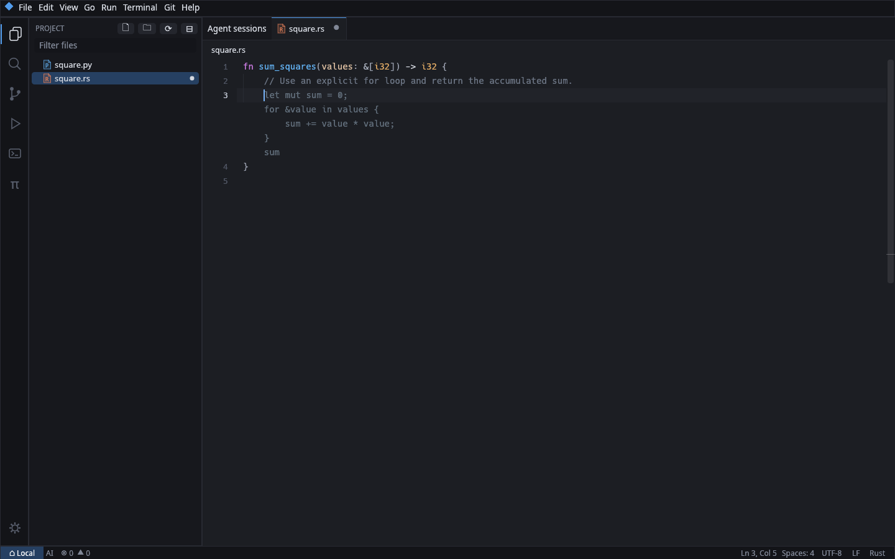
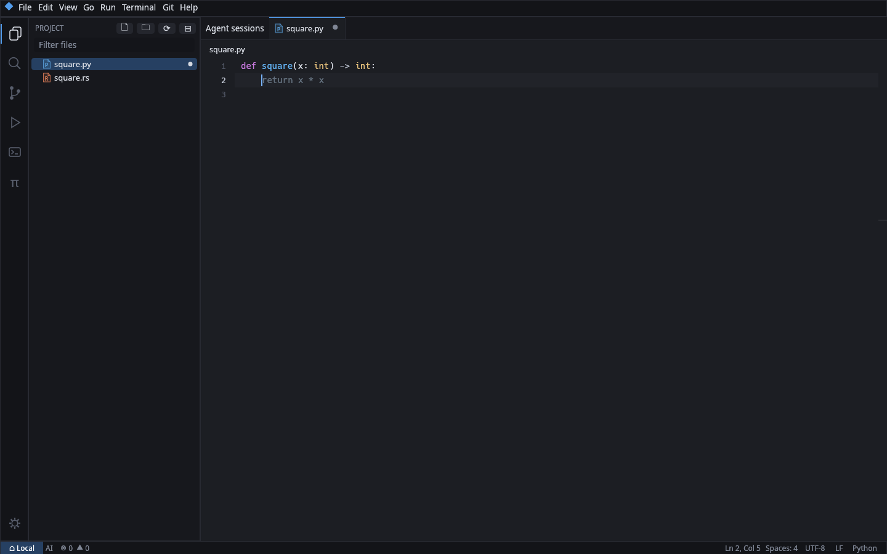

# Semantic inline completion

## Integration architecture

`text::Buffer` owns the Rope, character-based selections and monotonic version.
`apply_edits_with_selection` supplies one independent undo transaction. All edits,
including control socket/agent edits and disk reloads, change that version.
`app::editor` owns keyboard arbitration and a fixed-height, horizontally scrolling
line layout. LSP completion remains first in keyboard arbitration.
`app::lsp_manager` owns existing per-workspace clients and document synchronization;
inline collection borrows ready clients and their negotiated position encoding.
`syntax` owns the existing tree-sitter grammars. Inline syntax collection reuses
those grammars off the UI thread, without a second index or language server.

`inline_completion` adds a cancellable, single-flight background request, bounded
context/cache and provider interface. A request identity includes project,
document ID, buffer version, cursor and serial. UI renders only a matching ghost;
acceptance checks the identity again. Permission is stored per workspace in the
existing config, never with an API key. Remote workspaces are initially excluded
rather than allowing cloud requests to bypass their filesystem boundary.

Implementation stages: provider; controller; rendering/input; semantics;
cache/tests; integration. Network tests use a local server, never a real key.

## Enable and configure

Open a **local project**, then File → Settings → AI Inline Completion →
**Allow cloud completion for this project**. Permissions are off by default and
stored using the workspace's `local|absolute-root` key. Clearing the checkbox
cancels the current request, clears cached suggestions and disables sending.
No permission is inferred from having a key or using Pi agents. Once checked, simply type and accept with Tab; a manual request is optional. The global pause checkbox disables AI in all projects while retaining their permissions.

Credentials are read on the worker, without modification or copying, in Pi's
persistent precedence: `$PI_CODING_AGENT_DIR/auth.json` (default
`~/.pi/agent/auth.json`), its `models.json` OpenRouter `apiKey`, then
`OPENROUTER_API_KEY`. Literal values and environment references are supported,
including provider-specific `env`. Pi's `!credential-command` mechanism is not
executed; supply the environment key in that case. Project `.pi` files and
custom provider endpoints are not read. No credential appears in config.toml,
completion diagnostics, prompt logs or normal error messages.

The default model is `mistralai/codestral-2508`. Requests use the documented
[OpenRouter Chat Completions API](https://openrouter.ai/docs/api/api-reference/chat/send-chat-completion-request),
without FIM tokens, streaming, tools or agent editing. Temperature and maximum
output tokens can be changed in Settings. Further defaults in config.toml:

```toml
[inline_completion]
projects = [] # prefer the per-project consent checkbox
paused = false
model = "mistralai/codestral-2508"
temperature = 0.1
max_tokens = 96
timeout_ms = 6000
debounce_ms = 180
requests_per_minute = 12
requests_per_session = 300
session_budget_usd = 1.0
reserve_per_request_usd = 0.01
```

`Tab` accepts a visible suggestion in one undo transaction; `Esc` dismisses it
(or cancels pending generation). Typing, cursor changes, selection/multicursor,
project/tab switching and background edits invalidate it. The existing LSP popup
has first priority for Tab. Existing indentation and snippet insertion continue
on their usual path. `Ctrl+Space` remains LSP; the separate
`trigger_inline_completion` command defaults to **Ctrl+Alt+Space** and can be
rebound in Keyboard Shortcuts. An explicit AI request closes the LSP popup.

The status bar's **AI** indicator opens settings; **AI …** means a request is
running, **AI !** exposes the last error on hover. Metrics are available there
and through the read-only `state.inline_completion` control response. They store
counts, latency, token usage and cost, never source or generated suggestions.
Rejection counts represent explicit Escape dismissal/cancellation.

## Semantic context actually supplied

* A bounded prefix (6 KB) and suffix (1.8 KB), respecting UTF-8 boundaries.
* Existing tree-sitter grammars: enclosing function/method/impl/class header,
  imports and preceding local declarations in ancestor scopes. This is syntax,
  not invented type inference. Unknown languages fall back to prefix/suffix.
* Ready, existing LSP clients are selected by advertised capability, using each
  client's UTF-8/UTF-16 position encoding. Queries include hover, signatureHelp,
  completion, definition, typeDefinition, documentSymbol and references.
* Hover/signature/type information ranks before local declarations, available
  completion signatures, enclosing definitions and reference examples.
* Definition/type/reference locations yield a few lines from at most three
  locations per response, only inside the project. Unsaved open buffers take
  precedence over disk. No global file scan, embedding index or extra server.
* Collection has a 650 ms LSP budget, with at most 90 ms per method. Slow or
  unsupported methods are skipped; syntax/text fallback remains available.
  Missing types, traits, methods and expected types are never synthesized.
* Semantic text is capped at 4 KB; total user message is about 12 KB, generally
  around 3–4K tokens for ASCII code. This is a byte-based estimate, not a strict
  tokenizer guarantee for every language. Output is at most 512 configured
  tokens, 96 by default, with an 8 KB defensive insertion limit.

A single background request is allowed. Cursor/document/project/version/serial
checks suppress late answers; cancellation drops the HTTP future within roughly
20 ms, and LSP waits are bounded. The cache holds 16 exact-context insertion
results for 30 seconds (at most 128 KB of text). Filesystem changes, project and
settings changes invalidate it. No UI repaint loop is added while idle.

## Privacy and limits

Cloud completion is limited to local project files, excluding `.env*`, common
credential directories and private key files. Canonical paths reject symlinks
outside the project. Potential credentials in the selected context suppress the
request; sensitive semantic fragments are omitted. **This heuristic cannot
recognize every secret.** Permission to send project code remains necessary.
Remote workspaces, selections, multicursors, previews and documents over 256K
characters are intentionally excluded in this first implementation.

The API is insertion-only: it cannot run a command, read another file through a
tool, apply a patch or write a file. Markdown, prefix echoes, control characters
and oversized responses are rejected; duplicated suffix overlap is removed.
Untrusted context is explicitly identified as data in the prompt. Generation
can still be wrong; semantic facts constrain the prompt, not a type checker.

Request counts and the session spending gate are local safeguards. Reported
`usage.cost` is accumulated; calls with unknown/cancelled usage reserve the
configured per-call amount. A request already sent may be charged after local
cancellation. The local budget is not a hard billing guarantee: additionally
configure a spending cap for the API key in OpenRouter. HTTP 429 applies a
30-second cooldown. No streaming means there is no time-to-first-token metric;
latency measures collection plus the complete response.

## Verification

Ordinary tests never require credentials:

```sh
cargo fmt --all -- --check
cargo clippy --locked --workspace --all-targets -- -D warnings
cargo test --locked --workspace
```

They cover bounded Unicode windows, LSP positions, Rust/Python syntax scopes,
semantic ranking/budget, capability-aware JSON-RPC with a real fixture process,
project/symlink boundaries, credential precedence/no mutation, stale replies,
agent edits, document closure, atomic multiline Undo, LSP/Tab precedence,
virtual-row rendering at two font sizes, cache limits, missing keys, malformed
responses, network timeout/cancellation and HTTP 429 through a local mock server.
The JSON-RPC fixture uses Python 3 when available; the rest is Rust-only.

Explicit provider smoke test (sends only a synthetic Rust `square` function):

```sh
cargo test --locked --bin lumen-edit inline_completion::provider::tests::real_openrouter -- --ignored --exact --nocapture
```

Explicit native GUI/cloud acceptance (Linux, Xvfb, xdotool):

```sh
cargo build --locked --bin lumen-edit
python3 scripts/test-inline-completion.py --real-api target/debug/lumen-edit
```

This uses temporary HOME/config/project, existing Pi credentials read-only,
synthetic Rust/Python, a four-request limit, and checks automatic generation after real keyboard input, ghost/Tab/Undo via
native input and the control socket. It never enables the user's real projects.
Screenshots go to `/tmp/lumen-inline-rs.png` and `/tmp/lumen-inline-py.png`.

Measured provider-only smoke on 2026-10-24 with Pi credentials: **1.022 s**,
139 input / 4 output tokens, reported cost **$0.0000453**. The earlier environment
credential was rejected with HTTP 401; Pi's stored credential worked. Latency is
one sample, not a percentile or a promise for other projects/models/providers.

Native automatic typing acceptance on Rust/Python also passed: **2.025 s** for a
multiline Rust loop (187 input / 27 output tokens), **1.060 s** for Python (134
input / 6 output tokens). Total reported cost for those two calls: **$0.000126**.
Latest acceptance after indentation normalization: **1.337 s** Rust, **0.942 s**
Python; two-call cost **$0.00005688**. The model-free agent session GUI regression
suite passed as well. Final standard suite: **93 passed, 2 explicit tests ignored**;
those explicit OpenRouter and installed rust-analyzer tests were run separately
and passed. `fmt` and strict workspace/all-targets `clippy` passed.




## Changed files

New subsystem: `src/inline_completion/{mod,controller,provider,credentials,semantic,renderer}.rs`.
Integration: `src/app/{mod,editor,panel,status,commands,keymap,control,lsp_manager}.rs`,
`src/{main,config,syntax}.rs`. Dependencies: `Cargo.toml`, `Cargo.lock`.
UI catalog: `locales/ru.toml`. Documentation: this guide, `README.md`,
`README.ru.md`, `CHANGELOG.md`. Explicit native acceptance:
`scripts/test-inline-completion.py`. Screenshots: `docs/screenshots/inline-completion-{rust,python}.png`.
