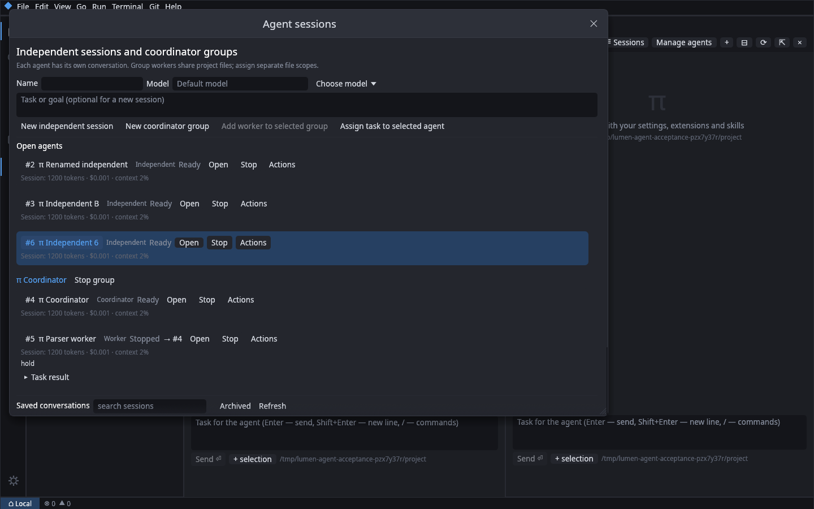

# Сессии и группы агентов

Откройте «Агент: управление сессиями» в палитре команд или нажмите «Агенты» в заголовке диалога Pi. Если открыто несколько агентов, кнопка π на левой панели открывает менеджер; он также доступен по правой кнопке на π.



На снимке — изолированные тестовые сессии.

## Независимые сессии

Введите имя и при необходимости выберите модель, затем нажмите «Независимая сессия». У каждого агента отдельный процесс Pi, история, очередь сообщений и состояние. «Открыть» возвращает к диалогу; выбор строки в менеджере задаёт получателя кнопки «Назначить задание».

В меню «Действия» доступны переименование, перезапуск, копирование сохранённого диалога, очистка очереди и закрытие. Для изменения модели уже открытого агента используйте выбор модели в его диалоге. Перезапуск открывает точный файл текущей сессии. Копирование создаёт отдельную историю на основе существующей, не продолжая запись в исходный файл.

Внизу менеджера находятся сохранённые диалоги, поиск и обновление списка. Открытие истории сохраняет остальные сессии и переводит фокус на уже открытый диалог, если он существует. Закрытую сессию можно убрать в архив; переключатель «Архив» позволяет восстановить её. Архивирование не удаляет данные и не перемещает открытые в этом окне сессии.

## Группа с координатором

1. Укажите имя и цель, затем нажмите «Группа с координатором». При заданной цели координатор начинает работу сразу; без цели он ожидает задания.
2. Выберите координатора или участника его группы, введите имя, модель и ограниченное задание исполнителя и нажмите «Добавить исполнителя в выбранную группу».
3. Координатор также может создавать исполнителей через инструменты редактора. Он получает инструкцию, как использовать API; исполнителям запрещено рекурсивное распределение заданий через этот API.
4. После завершения или ошибки задания редактор отправляет результат именно координатору группы. Если координатор занят, отчёт попадает в его очередь последующих сообщений. Длинные отчёты ограничиваются 12 000 символами при передаче; полный результат остаётся у исполнителя и доступен через список агентов и transcript.
5. «Остановить группу» отменяет текущую работу координатора и всех исполнителей, очищает очереди и приостанавливает доставку результатов. «Возобновить группу» явно разрешает доставку накопленных результатов. Закрытие координатора останавливает группу и оставляет сессии исполнителей независимыми.

Участники работают с общими файлами проекта. Назначайте непересекающиеся области изменений; автоматические git worktree и автоматическое слияние изменений не создаются. Можно открыть до 24 агентов, в одной группе — до 8 исполнителей. Создание сессии без задания не запускает запрос к модели.

## Восстановление и подтверждения

Редактор сохраняет открытые сессии, имена, группы, незаконченный ввод и последнее задание отдельно для каждого проекта. После перезапуска он загружает историю, но не отправляет задания снова. Прерванные задания помечаются отменёнными; назначьте их повторно для продолжения. Пустые сессии, для которых Pi ещё не создал JSONL, восстанавливаются как новые диалоги с сохранённым именем и черновиком.

Жёлтый индикатор π и статус в менеджере показывают, что фоновый агент ждёт ответа. Откройте его диалог, чтобы ответить. Содержимое длинных подтверждений прокручивается отдельно от кнопок ответа. Истёкшие запросы расширений убираются и у скрытых агентов.

## CLI и MCP

Операция `agent` принимает адресный параметр `agent` — ID из `action=list`. ID сохраняется при перезапуске процесса внутри окна, но после перезапуска редактора нужно заново получить список; связи участников группы восстанавливаются автоматически.

```sh
lumen-edit agent --action list --json
lumen-edit agent --action manager
lumen-edit agent --action create --role coordinator --name review
lumen-edit agent --action create --coordinator 2 --name parser --text 'Проверь только парсер и сообщи о найденных ошибках'
lumen-edit agent --action transcript --agent 3 --json
lumen-edit agent --action group_stop --agent 2
```

Замените ID примера на значения из вашего списка. Доступны также `dispatch`, `focus`, `close`, `restart`, `rename`, `clone`, `resume_group`, `prompt`, `follow_up`, `clear_queue`, `sessions`, `switch` и `new_session`. Вызовы из процесса агента получают его ID через окружение, поэтому активная вкладка редактора не меняет адресата фонового агента. Это ограничение маршрутизации штатных инструментов, а не изоляция процессов от произвольного кода в проекте.

Полная ревизия возможностей до изменений: [pi-integration-audit.md](pi-integration-audit.md). Дерево сессии, произвольные терминальные компоненты расширений, бинарные изображения и управление провайдерами в этой работе не добавлялись.
